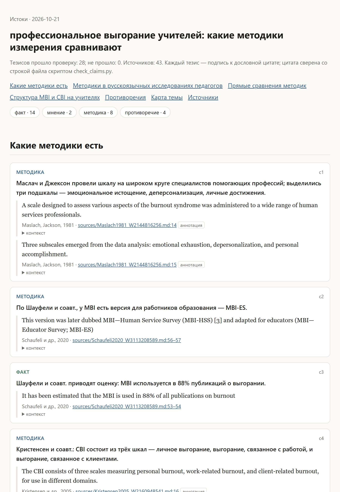
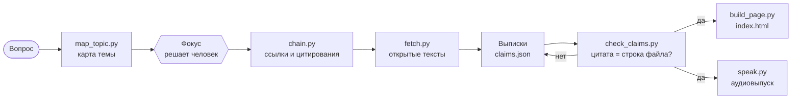

<div align="center">

# Истоки · istoki

**Навык для Claude Code: разобраться в незнакомой теме по первоисточникам — без пересказа.**

Карта темы → цепочки ссылок и цитирований → открытые тексты на диске → тезисы с дословными цитатами, проверенными до строки.

[](LICENSE)


[Что делает](#что-делает) · [Как работает](#как-работает) · [Установка](#установка) · [Использование](#использование) · [Аудио](#аудиовыпуск) · [Ограничения](#ограничения-и-этика)

</div>

> **English summary.** *Istoki* ("sources") is a Claude Code skill for source-grounded topic exploration. It maps a topic (terms, key authors, venues) via OpenAlex and CyberLeninka, chains backward references and forward citations, downloads open-access full texts, and outputs an evidence page where **every claim is a verbatim quote pinned to `file:line` and machine-checked**. Optional: a short narrated audio digest (local Silero TTS or ElevenLabs). Built on Ellis's, Bates's and Kuhlthau's information-seeking models. Docs are in Russian.

---

## Что делает

Вы задаёте вопрос, например:

> «профессиональное выгорание учителей: какие методики измерения сравнивают»

Навык:

1. **строит карту темы** — термины, ключевые авторы, журналы, кандидаты в ядро;
2. **останавливается и спрашивает фокус** — что именно вам важно;
3. **идёт по цепочкам** — ссылки назад и цитирования вперёд через OpenAlex;
4. **скачивает первоисточники** в открытом доступе и переводит их в текст с номерами строк;
5. **делает выписки**: каждый тезис — дословная цитата и `sources/<файл>.md:<строка>`;
6. **проверяет каждую цитату скриптом** — тезис без подтверждения не попадает в выдачу;
7. **собирает HTML-страницу** с выписками, противоречиями между авторами и картой темы;
8. по запросу — **аудиовыпуск** на 3–5 минут: факты, мнения, противоречия, у каждой фразы назван автор.

Чего навык **не** делает: не пишет обзор «своими словами» и не опирается на память модели о том, «что обычно пишут авторы».

<p align="center">
  <picture>
    <source media="(prefers-color-scheme: dark)" srcset="docs/page-dark.png">
    
  </picture>
  <br><sub>Страница выписок первого прогона: каждый тезис — подпись к цитате со ссылкой <code>sources/…md:строка</code>.</sub>
</p>

### Первый прогон: цифрами

Вопрос: «профессиональное выгорание учителей: какие методики измерения сравнивают» (21.10.2026).

| Этап | Результат |
|---|---|
| Карта темы | 8 запросов (рус. и англ.) → 214 работ OpenAlex + 53 из КиберЛенинки |
| Фокус и ядро | 10 работ: обзоры психометрики, MBI-ES, CBI, BAT на учителях |
| Цепочки | 483 кандидата; по ссылкам назад нашлись исходные публикации MBI (1981), CBI (2005), BAT (2020), OLBI |
| Скачивание | 43 источника: 12 полных текстов, 30 только с аннотацией, 1 без текста |
| Выписки | 28 тезисов, 60 цитат, все прошли проверку строк |
| Смысловая сверка | агент-сверщик нашёл 7 подписей, которые говорили больше цитаты (например, «positively phrased items» переведено как «прямые пункты»), и 15 мест, где выборку нужно подтвердить второй цитатой. Всё исправлено до выдачи |
| Аудио | 3 мин 36 с, Silero; распознавание Whisper подтвердило, что все числа прочитаны |
| Противоречия | 4: какая шкала лучше (MBI или CBI), позитивно сформулированные пункты, состав выгорания, заменять ли MBI |
| Запросы OpenAlex | около 60 |

### Что получается на выходе

```
istoki/teacher-burnout/
├── map.md                 # карта темы: термины, авторы, площадки, журнал запросов, фокус
├── candidates.md          # кандидаты из цепочек с рангом и путём («назад ×6», «вперёд от W…»)
├── sources/
│   ├── Kristensen2005_W2160948541.md   # текст с метками [стр. N] — на его строки ссылаются тезисы
│   ├── …
│   ├── pdf/               # оригиналы PDF
│   └── index.json         # статус каждого источника: полный текст / только аннотация / нет текста
├── claims.json            # тезисы и выписки
├── claims.checked.json    # они же после проверки
├── index.html             # страница с выписками
└── audio/                 # по запросу: episode.mp3, transcript.md
```

## Как работает



### Три модели поиска — и что они меняют в работе

| Модель | Суть | Что делает навык |
|---|---|---|
| **Эллис** (1989; Ellis, Cox, Hall, 1993) | Поиск — набор действий: старт, цепочки, просмотр, отбор, слежение, извлечение, проверка, завершение | Каждое действие — шаг конвейера и отдельный скрипт |
| **Бейтс**, «сбор ягод» (1989) | Запрос меняется по ходу, ответ собирается по кусочкам | Новые термины из найденного уходят в следующий запрос; журнал запросов в `map.md` |
| **Култау**, ISP (1991) | До формулировки фокуса растёт неуверенность | Обязательная остановка после карты: без выбора фокуса массового скачивания нет |

Подробно — [`references/models.md`](references/models.md).

### Как проверяются цитаты

`check_claims.py` сравнивает цитату с файлом источника **строго по всем буквам, цифрам и знакам** — минус, `<` и `>`, запятая в числе. Мягко — только к пробелам и переносам строк, переносу слова по слогам («выго-рание»), виду кавычек и тире, лигатурам и границам страниц. Цитата должна **начинаться с начала слова на указанной строке**; если она есть в файле, но в другом месте, скрипт подскажет верную строку.

Подделать источник нельзя: файл должен быть в `sources/index.json`, его контрольная сумма — совпадать с той, что записал `fetch.py`, а статус — «полный текст» или «только аннотация». Страница и аудио не верят готовому отчёту проверки и перепроверяют выписки сами.

Вторая проверка — смысловая: отдельный агент-сверщик ищет тезисы, где подпись говорит больше, чем цитата (другая выборка, сильнее модальность, причинность).

```bash
python tests/test_core.py   # 27 регрессионных случаев: изменённые числа, подделанный файл, цитата с середины слова…
```

## Установка

```bash
git clone https://github.com/lanschikovdn/istoki ~/.claude/skills/istoki
pip install -r ~/.claude/skills/istoki/requirements.txt
```

Нужны Python 3.10+ и `ffmpeg` в PATH (только для аудио).

**Ключ OpenAlex (рекомендуется).** С 2026 года без ключа все запросы с одного IP делят общий бесплатный бюджет — около 1000 запросов в сутки. Один прогон темы тратит 50–80. Бесплатный ключ: <https://openalex.org/settings/api>.

```bash
export OPENALEX_API_KEY=ваш_ключ
```

## Использование

В Claude Code:

```
/istoki профессиональное выгорание учителей: какие методики измерения сравнивают
```

или просто: «помоги разобраться в теме…», «найди первоисточники по…», «какие методики сравнивают…».

Скрипты работают и сами по себе:

| Скрипт | Что делает | Запросы OpenAlex |
|---|---|---|
| `map_topic.py --dir D --question "…" --q "…" --q "…"` | Карта темы; повторный запуск дополняет | 3 на запрос |
| `chain.py --dir D --core W… W… --terms "…" --hops 2` | Ссылки назад и цитирования вперёд от ядра; второй шаг назад — к исходным публикациям | ~1 на 50 работ + 1 на работу ядра |
| `fetch.py --dir D --ids W… CL…` или `--top N` | Скачивание открытых текстов, PDF → текст с номерами строк; `--confirm` — подтвердить источник после проверки глазами | 0 |
| `check_claims.py --dir D` | Проверка выписок | 0 |
| `build_page.py --dir D` | `index.html` | 0 |
| `speak.py --dir D [--engine silero\|edge\|elevenlabs]` | Аудиовыпуск | 0 |

Формат выписок — [`references/claims.md`](references/claims.md).

## Аудиовыпуск

Короткий рассказ: факты, мнения, противоречия. Каждая фраза сценария имеет ссылку на проверенный тезис, иначе выпуск не собирается. Транскрипт ведёт к файлам и строкам.

| Движок | Где | Как включить |
|---|---|---|
| **Silero** `v5_ru` (по умолчанию) | Локально, CPU | `pip install torch --index-url https://download.pytorch.org/whl/cpu` и `pip install -r requirements-audio.txt` |
| **ElevenLabs** | API, платно | `ELEVENLABS_API_KEY`, `--engine elevenlabs --voice <voice_id>` |
| **edge-tts** | Облако Microsoft, бесплатно | `pip install edge-tts`, `--engine edge` |

> [!WARNING]
> Silero молча **пропускает цифры и латиницу**. `speak.py` сам переводит числа в слова («−0,32» → «минус ноль целых тридцать две сотых»), а на латиницу, греческие буквы и знаки вроде `<` останавливается и называет символы, которые нужно записать по-русски.

Правила сценария — [`references/audio.md`](references/audio.md).

## Режим «объяснить»

Из проверенных выписок навык строит объяснение: текст по правилам ясного языка ([`references/ste-ru.md`](references/ste-ru.md) — адаптация ASD-STE100 для русского), схему, отдельную HTML-страницу или видео (HyperFrames). См. [`references/explain.md`](references/explain.md).

## Ограничения и этика

- **Только открытый доступ.** Источники — OA-локации OpenAlex, Europe PMC и КиберЛенинка. Никаких теневых библиотек, обхода платного доступа и страниц-проверок для ботов: ответ 403 — значит, нет. Для закрытой работы сохраняется аннотация с пометкой. В первом прогоне классика (MBI 1981, CBI 2005, OLBI 2005) была доступна только аннотацией.
- **Русская литература.** В OpenAlex русских работ по названию почти нет — русская часть идёт через КиберЛенинку, и там больше эмпирики («выгорание и X»), чем сравнений методик.
- **Скачанные тексты — чужие.** Они остаются у вас на диске; `.gitignore` не пускает `sources/` и аудио в репозиторий.
- **eLIBRARY** не имеет открытого API — оттуда навык ничего не берёт.
- **Сканы** без текстового слоя не распознаются: цитировать их нельзя.
- Название в PDF не совпало с ожидаемым → статус «ПРОВЕРИТЬ»: агент открывает файл и убеждается, что это та работа.

## Лицензии

- Код навыка — [MIT](LICENSE).
- Модели Silero `v5_ru` — **CC BY-NC-SA 4.0, только некоммерческое использование**. Модели скачиваются у пользователя и в репозиторий не входят. Для коммерческих задач — `v5_cis_base` (MIT) или другой движок.
- Данные — [OpenAlex](https://openalex.org) (CC0) и [КиберЛенинка](https://cyberleninka.ru).

## Благодарности

- [OpenAlex](https://openalex.org) — открытый граф научных работ.
- [Silero Models](https://github.com/snakers4/silero-models) — русский синтез речи.
- [Neal Caren, lit-search (sociology-skillset)](https://github.com/nealcaren/sociology-skillset) — идея поэтапного обзора с обходом цитирований. Код не заимствован.
- Bates M. J., Ellis D., Kuhlthau C. C. — модели, на которых построен навык.
